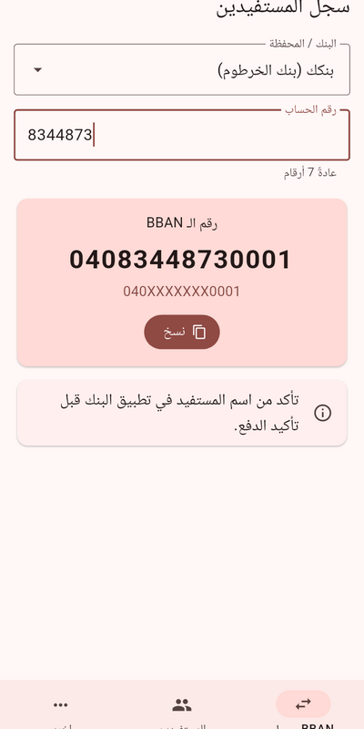
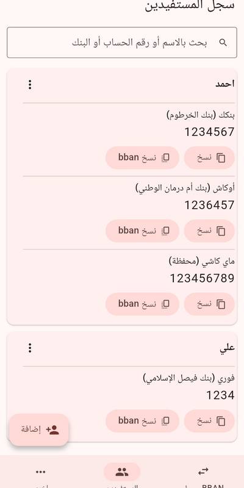
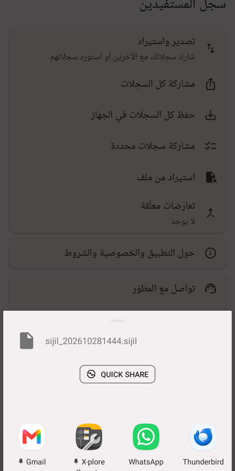
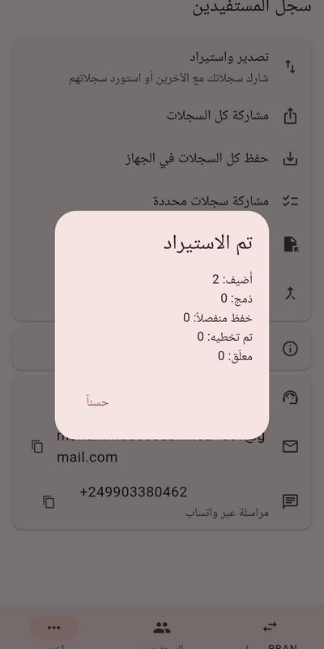

# My Beneficiaries (سجل المستفيدين)

<div dir="rtl">

**سجل المستفيدين** تطبيق أندرويد يعمل دون إنترنت: يحوّل رقم حساب البنك أو المحفظة إلى رقم BBAN من 14 خانة، ويحفظ قائمة مستفيديك على هاتفك فقط. بلا حسابات وبلا إعلانات وبلا تتبّع. حمّل ملف APK من صفحة [الإصدارات](https://github.com/gatogato999/beneficiaries/releases)، وتأكد دائماً من اسم المستفيد في تطبيق البنك قبل الدفع.

</div>

---

An offline Android app, built with Flutter, that turns a Sudanese bank or wallet account number into the 14-digit **BBAN** and keeps a **private beneficiaries list** on your phone. Arabic interface (right to left), no accounts, no ads, no tracking.

<!-- SCREENSHOTS-START -->
<p align="center">   </p>
<!-- SCREENSHOTS-END -->

## Download

Get the APK from the [Releases page](https://github.com/gatogato999/beneficiaries/releases).

| File | For |
|---|---|
| `...-arm64-v8a.apk` | almost every phone from the last 8 years |
| `...-armeabi-v7a.apk` | old 32-bit phones |

Android will ask you to allow installing from this source. Compare the download with `SHA256SUMS` if you like (`sha256sum -c SHA256SUMS`). A Google Play release is being prepared.

## Features

- **BBAN converter:** pick the bank or wallet, type the account number, copy the result in one tap. A reminder asks you to check the receiver's name before paying.
- **Beneficiaries book:** people with one or more accounts each, search by name, number or bank, copy the account number or the BBAN straight from the list.
- **Share, save and import:** send selected records (or all) through the normal Android share menu, save a file on the phone, or import files made by other users. When the same person already exists you choose to merge or keep both, for one record or for all, or decide later.
- **Private by design:** records never leave the device unless you share them. The app needs no sensitive permissions and has no network code.

## Supported banks and wallets

| Name | Arabic | BBAN pattern (X = your account, left-padded with zeros) |
|---|---|---|
| Bankak | بنكك (بنك الخرطوم) | `040XXXXXXX0001` |
| O-Cash | أوكاش (بنك أم درمان الوطني) | `24XXXXXXX00001` |
| Fawry | فوري (بنك فيصل الإسلامي) | `02XXXXXXXX0001` |
| MyCashi | ماي كاشي (محفظة) | `070XXXXXXXXX98` (format not yet verified) |
| Mashreq | مشرق (بنك النيل الأزرق) | `150000XXXXXXXX` |
| Aman Plus | أمن بلس (البنك الإسلامي السوداني) | `140XXXXXXX0001` |
| Masrafak | مصرفك (بنك المزارع التجاري) | `222XXXXXXXXXXX` |
| French Sudanese Bank | البنك الفرنسي السوداني | `110XXXXXX00001` |
| Zirai Mobile | الزراعي موبايل (البنك الزراعي السوداني) | `03XXXXXXX01001` |
| Salam Bank | بنك السلام السوداني | `180XXXXXX00001` |
| Al Baraka Bank | بنك البركة السوداني | `070XXXXXX00001` |
| Animal Resources Bank | بنك الثروة الحيوانية | `090XXXXXX00001` |
| Real Estate Commercial Bank | البنك العقاري التجاري | `210XXXXXX00001` |
| Industrial Development Bank | بنك التنمية الصناعية | `130XXXXXX00001` |
| United Capital Bank | بنك المال المتحد | `170XXXXXX00001` |

More are added over time. A correction or a new bank needs one line in `lib/banks.dart` and a test.

## How the conversion works

`BBAN = prefix + account (left-padded with zeros) + suffix`, always 14 digits. Leading zeros you type are ignored, so the short and long forms of an account give the same result. Example: Bankak account `1234567` gives `04012345670001`. The formats follow publicly known patterns and can change, so always confirm the receiver's name in your bank app before paying.

## Privacy

Everything stays on your device. Read the [Privacy Policy](https://gatogato999.github.io/beneficiaries/privacy/) and the [Terms of Use](https://gatogato999.github.io/beneficiaries/terms/). The project is independent and not affiliated with any bank or wallet provider.

## Build from source

Needs the Flutter stable SDK and the JDK that ships with Android Studio. Only two packages are used (`path_provider`, `share_plus`).

```bash
git clone https://github.com/gatogato999/beneficiaries.git && cd beneficiaries
flutter pub get
# optional: contact details shown on the Other tab, kept out of git
mkdir -p ~/.config/sijil
printf '{"DEV_EMAIL":"you@example.com","DEV_PHONE":"+249000000000"}\n' > ~/.config/sijil/contact.json
flutter run --dart-define-from-file=$HOME/.config/sijil/contact.json
flutter test
```

Release builds are signed with a private key that is not in this repository. `release.sh` builds, tags and archives a release, and `play_preflight.sh` runs the checks needed before a Google Play upload.

## Project layout

| Path | What it holds |
|---|---|
| `lib/banks.dart` | bank formats and the BBAN conversion |
| `lib/store.dart`, `lib/models.dart` | local storage, import rules, duplicate handling |
| `lib/*_tab.dart`, `lib/person_editor.dart`, `lib/about_page.dart` | the screens |
| `android/.../MainActivity.kt` | small native bridge: open-with, file picker, save-as, links |
| `test/` | unit tests for the BBAN rules |
| `docs/` | GitHub Pages: privacy policy, terms, support page |
| `release.sh`, `play_preflight.sh` | release and pre-upload tooling |

## Feedback

Found a bug or a wrong bank format? [Open an issue](https://github.com/gatogato999/beneficiaries/issues/new/choose). Never paste real account numbers or names.

Planned: Google Play release, an optional crash report that the user sends by email, more banks.

## License

All rights reserved for now. If you would like to reuse parts of the code, open an issue and ask.


